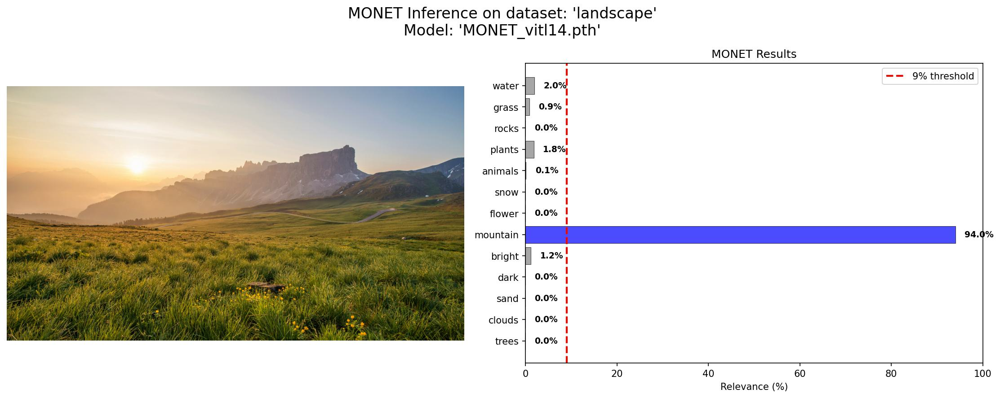
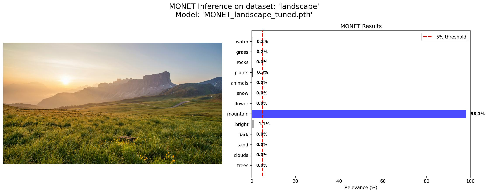
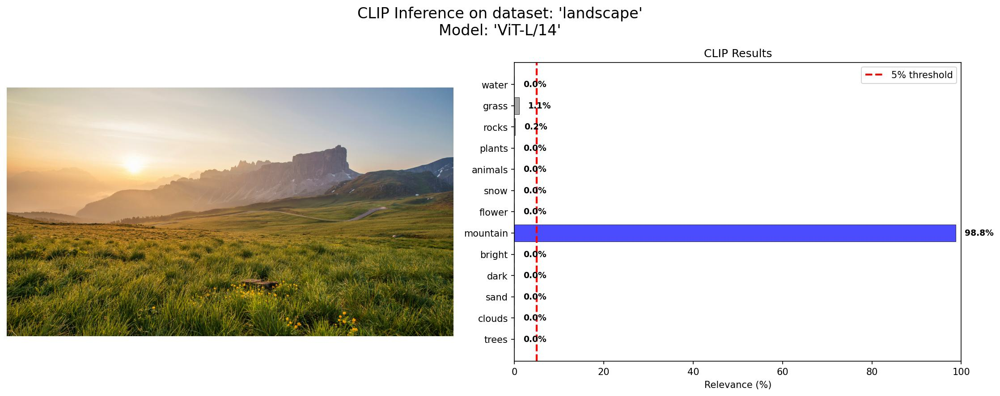
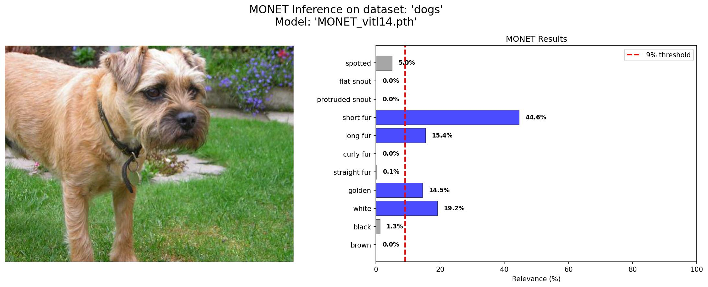
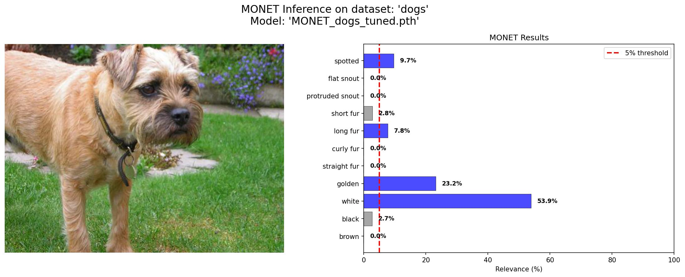
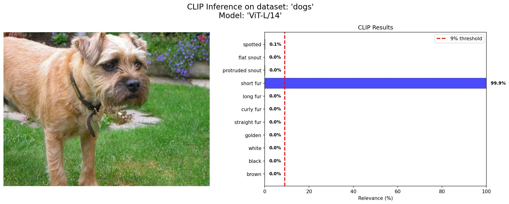

# Explainable AI with Vision-Language Models: Replicating and Exploring MONET

This project replicates and evaluates **MONET** (Medical cONcept rETriever, Kim et al., *Nature Medicine*, 2024), a vision-language model fine-tuned from **CLIP ViT-L/14** that scores how strongly an image matches text concepts. The goal was to understand how concept-based explainable AI works and to test how well MONET generalizes outside dermatology.

## What was done

| Stage | Data | Goal |
|---|---|---|
| **Stage 1** | Dog and landscape photos (non-medical) | Compare **MONET**, **MONET fine-tuned** on our own annotations, and **CLIP** ViT-L/14 |
| **Stage 2** | Tissue ultrasound images (confidential, not included) | Preliminary zero-shot test of MONET with four tumor-related descriptors |

## Stage 1: dogs and landscapes

- 70 images per dataset: 50 for fine-tuning, 20 for testing.
- Descriptors: 11 for dogs (e.g. "curly fur", "flat snout") and 13 for landscapes (e.g. "water", "mountain").
- Fine-tuning: manual annotations, 10 epochs, batch size 8, learning rate 1e-6, symmetric contrastive loss (cross-entropy on image-text and text-image similarities). The image encoder is frozen and the text side is trained.
- Detection thresholds were set empirically: 9% for MONET, 5% for MONET fine-tuned and CLIP.

**Results on the 20 test images per dataset** (relative accuracy = correct / (correct + incorrect) descriptors above the threshold):

| | Landscape: correct | incorrect | R.A. | Dogs: correct | incorrect | R.A. |
|---|---|---|---|---|---|---|
| MONET | 32 | 9 | 78% | 28 | 18 | 60.9% |
| MONET fine-tuned | 29 | 3 | 90% | 31 | 24 | 56.4% |
| CLIP | 28 | 1 | 96.6% | 20 | 10 | 66.7% |

**Observations**
- CLIP is the most reliable overall, thanks to its large general-purpose training.
- MONET keeps much of CLIP's general knowledge, which explains its good landscape results despite its dermatology training.
- Fine-tuning on only 50 images changes the model clearly: it starts picking up new descriptors such as "water", "mountain" and "curly fur". It also makes more errors, probably because of the small dataset.

**Examples** (same test image, three models; the red line is the decision threshold):

| MONET | MONET fine-tuned | CLIP |
|---|---|---|
|  |  |  |
|  |  |  |

More examples are in [`results/`](results/).

## Stage 2: ultrasound (preliminary)

MONET was applied **without fine-tuning** to ultrasound images from a lab collection: 105 tumoral (T) and 174 non-tumoral (NT). Four descriptors, taken from the radiology literature, were scored:

- A1: mass with ill-defined margins
- A2: mass across tissue planes
- A3: mass with posterior acoustic shadowing
- A4: mass with heterogeneous internal texture

**Share of images where each descriptor exceeds the threshold:**

| | NT (10%) | NT (15%) | T (10%) | T (15%) |
|---|---|---|---|---|
| A1 | 64.37% | 30.46% | 41.90% | 17.14% |
| A2 | 4.60% | 3.45% | 36.19% | 28.57% |
| A3 | 100% | 100% | 100% | 99.05% |
| A4 | 14.94% | 0.57% | 2.86% | 0% |

**Images with at least 3 simultaneous descriptors above the 10% threshold:** T 33.33% vs NT 18.39%.

**Observations**
- A3 is detected on almost every image, so it does not discriminate.
- A2 ("mass across tissue planes") separates the two classes best.
- A single descriptor is not enough. MONET's usefulness here comes from combining several descriptors.
- These are preliminary results on a small, unbalanced dataset, with no clinical validation.

Raw output counts are in [`results/stage2_ultrasound/`](results/stage2_ultrasound/).

**Data statement:** the ultrasound images came from a confidential lab collection. They are **not included** and were deleted after the project. The Stage 2 script (`5_monet_test_lis.py`) is included for transparency, but it **cannot be run** without that data.

## Repository structure

```
.
├── 1_monet_init.py          # loads the original MONET model
├── 2_monet_finetune.py      # fine-tunes MONET on dogs or landscape
├── 3_monet_test_all.py      # tests MONET (original / fine-tuned)
├── 4_clip_test_all.py       # tests CLIP ViT-L/14
├── 5_monet_test_lis.py      # Stage 2: MONET on ultrasound images (data not included)
├── support_functions.py     # helper functions and plotting
├── requirements.txt
├── data/                    # annotations, file lists, samples (see data/README.md)
└── results/                 # example outputs
```

## Setup

```bash
conda create -n monet python=3.9
conda activate monet
pip install -r requirements.txt
```

Tested with PyTorch 1.13.0, torchvision 0.14.0 and CUDA 12.6 (WSL, Miniconda).

**Model weights are not included.** Get `MONET_vitl14.pth` by following the instructions in the [official MONET repository](https://github.com/suinleelab/MONET) and place it in a folder named `MONET Weights/`. CLIP ViT-L/14 weights are downloaded automatically by the [`clip`](https://github.com/openai/CLIP) package.

## Data

The full image sets are not redistributed (size and licensing). See [`data/README.md`](data/README.md) for the annotations, file lists and how to rebuild the datasets.

## Usage

Run scripts 1 to 4 in numerical order from the repository root. Set `datasetFlag` at the top of each script to `"dogs"` or `"landscape"`.

Script 5 expects ultrasound images in `data/LIS/T` and `data/LIS/NT`. This dataset is confidential and not provided, so the script is there to document the Stage 2 method only.

## Notes and limitations

- The reported results come from the original experiments. For publication, the scripts were reorganized (data paths) and the training images are now sorted numerically so they match the annotation order. They were **not re-run afterwards**, so small differences from the reported numbers are possible.
- Only 20 test images per dataset and 50 training images, so the conclusions are indicative, not statistically strong.
- Thresholds were chosen empirically after looking at the results.
- Landscape descriptors were chosen less rigorously than the dog descriptors, which come from standard dog-breed terminology.

## Credits

- **Authors:** Zineb Sabri and Jesús Tamez-Duque
- **MONET:** Kim et al., *Transparent medical image AI via an image-text foundation model grounded in medical literature*, Nature Medicine 30 (2024). [Code](https://github.com/suinleelab/MONET)
- **CLIP:** Radford et al., *Learning Transferable Visual Models From Natural Language Supervision*, ICML 2021. [Code](https://github.com/openai/CLIP)
- Images: [dog.ceo](https://dog.ceo/) / Stanford Dogs and [Unsplash](https://unsplash.com/) photographers.

